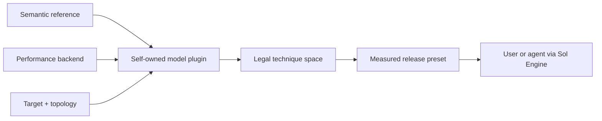

# Sol Engine

Sol is an adaptation-first engine for producing and running optimized generative-model releases. The repository is intentionally a **blank slate**: it ships no model, optimization implementation, historical experiment, or benchmark claim yet.

That emptiness is a product constraint, not missing cleanup. A model enters Sol only after one vertical plugin owns its semantics, performance backend, target-specific optimization space, evidence, and released presets.

## One surface, three users

- An ordinary user runs an already optimized model with one released preset.
- An advanced user inspects the plan and target-specific search space, then changes a small model-owned configuration.
- A maintainer or agent produces that release through the same plugin and Engine contract.

The production and release loops therefore improve each other: modularity that makes a release easy to use also reduces an agent's working domain from arbitrary model/architecture/backend code to verified seams, technique integration, and bounded tuning.

## Current state

Install the dependency-light control plane:

```bash
python3 -m pip install -e .
sol doctor
sol models
```

The expected output today is a healthy Engine with zero model plugins. Sol does not pretend that a historical config is a supported release. `sol models` shows releases; maintainers may use `sol models --all` to include drafts.

After a plugin is accepted, the user surface is:

```bash
sol inspect MODEL --preset PRESET --target TARGET
sol run MODEL --preset PRESET --target TARGET -- --prompt "..."
```

`inspect` resolves the exact command, environment, backend, target, and metadata without running a model. `run` executes that same validated plan without a shell.

## What Sol is based on

Sol is not a third model zoo and does not choose one framework as the universal source of truth:



- Prefer a maintained semantic reference such as Diffusers when it supports the model. It defines preprocessing, scheduling, components, and correctness.
- Use a performance backend such as SGLang when it supports the model and target. It owns runtime, distributed execution, and optimized kernels.
- Let the model plugin connect those two worlds and explicitly reject gaps. Sol owns the contract, target, composition, evidence, and release—not another complete architecture implementation.

Neither Diffusers nor SGLang is mandatory by name. A model may use another maintained reference or backend, but it must preserve the same boundaries and evidence contract.

## Architecture

There is no central model catalog and no import-for-registration. Discovery scans self-owned `plugin.toml` files as data and imports one provider only after the caller selects it.

```text
sol/
├── contracts.py       # ModelPlugin and ExecutionPlan contracts
├── discovery.py       # lazy, collision-safe manifest discovery
├── engine.py          # inspectable search/run surface
├── adaptation.py      # durable production state machine
├── scaffold.py        # model-owned vertical-slice generator
└── plugins/           # deliberately empty until a model is adapted

.agents/skills/sol-adapt-model/
├── SKILL.md           # agent entry point
└── references/        # workflow, evidence, tuning, retired-prototype lessons
```

A future model is cohesive rather than scattered:

```text
sol/plugins/<model>/
├── plugin.toml        # id, provider, lifecycle status, supported surfaces
├── plugin.py          # reference/backend/target/preset/space/plan ownership
└── presets/           # optional larger target-specific release data
```

The manifest is the model's sole discovery identity. There is no second row in a global registry to keep synchronized.

## Model production with an agent

Start one durable adaptation:

```bash
sol adapt start minimax_h3 \
  --reference diffusers \
  --backend sglang \
  --target h100_sxm_80gb_x4 \
  --budget 40
```

Then an agent repeatedly asks the Engine for one bounded task:

```bash
sol adapt next RUN_ID --json
sol adapt scaffold RUN_ID
sol adapt submit RUN_ID --evidence evidence.json
```

The lifecycle is:

```text
scope -> scaffold -> reference -> dense backend -> seams -> search space
      -> tune -> accept -> release candidate -> human approval -> released
```

State and accepted evidence live under `${SOL_STATE_HOME:-${XDG_STATE_HOME:-~/.local/state}/sol}/adaptations/`, outside Git. Each `next` response declares the current task, allowed repository paths, acceptance criteria, and required evidence. `submit` advances exactly one stage and fails closed on malformed, missing, over-budget, or out-of-scope evidence.

Invoke the repository-local `$sol-adapt-model` skill once to let a compatible coding agent follow this loop. The skill does not encode a second workflow: it calls `sol adapt`, reads its task contract, and stops at blockers or `awaiting_approval`. A maintainer completes the gate explicitly:

```bash
sol adapt approve RUN_ID --by MAINTAINER
```

Approval changes the model manifest from `draft` to `released`. It does not push, publish, or deploy anything.

## Customization and search

Search is a policy over a plugin's executable space, not a permanent top-level subsystem:

```bash
sol space MODEL --backend BACKEND --target TARGET
```

The returned dimensions are legal only for that model, backend, and target. An advanced user or any search agent can sweep them, but the Engine schema does not depend on a particular tuner. Engine validates names, types, ranges, and categorical values; the plugin validates cross-option constraints. A winning candidate becomes a named model-owned preset only after acceptance.

Use the same plan surface for a one-off customization:

```bash
sol inspect MODEL --preset PRESET --target TARGET \
  --set cache.threshold=0.25 \
  --set sparse.density=0.10
```

Overrides make a candidate, not a new released preset. The resolved values are recorded in `ExecutionPlan.options`, so they cannot be silently ignored.

In Python:

```python
from sol import Engine

engine = Engine()
space = engine.search_space("MODEL", backend="BACKEND", target="TARGET")
plan = engine.inspect(
    "MODEL",
    preset="PRESET",
    target="TARGET",
    options={"cache.threshold": 0.25},
)
```

Optimization components are not globally registered merely because code exists. A model plugin exposes only components whose insertion points, guards, backend mapping, target support, and engagement checks have been verified.

## Why the old directories are gone

- There is no `recipes/`: a released composition is a model-owned preset.
- There is no checked-in `runs/`: runtime and adaptation artifacts are external state.
- There is no global `search/` or `search_space/`: the plugin derives a bounded space for the selected backend and target.
- There is no permanent `evals/`: evaluation evidence is required by the adaptation stage and stored with that run; reusable evaluators should become ordinary packages only when more than one plugin needs them.
- There is no `techniques/` tree detached from models: reusable implementations may be introduced later behind a verified plugin seam, but unintegrated technique inventory is not product capability.

The retired prototype's reusable lessons were distilled into [the agent playbook](.agents/skills/sol-adapt-model/references/legacy-model-lessons.md). Its old thresholds and timings are search priors, never release claims.

## Release bar

A model is releasable only when it has:

- a pinned semantic reference and deterministic artifacts;
- a dense performance-backend parity result;
- explicit optimization seams and dense fallbacks;
- a bounded space tied to hardware and distributed topology;
- raw same-topology baseline/candidate samples and technique engagement proof;
- a passing quality gate and interaction matrix;
- a replayable, inspectable named preset;
- passing repository checks and attributable maintainer approval.

## Development

The control plane has no GPU dependency:

```bash
PYTHONDONTWRITEBYTECODE=1 PYTHONNOUSERSITE=1 \
  python3 -m unittest discover -s tests -v
python3 -m compileall -q sol tests
sol doctor
git diff --check
```

GPU dependencies belong to the selected model/backend integration and must not be imported during discovery.
