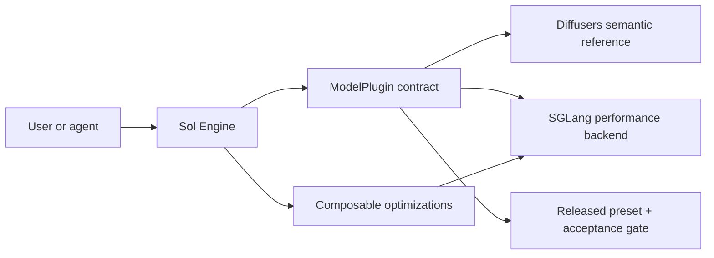
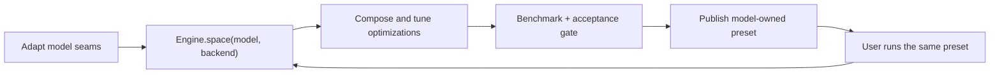

<p align="center">
  
</p>

<h3 align="center">Composable acceleration for video generation</h3>

<p align="center">
  <a href="https://nvlabs.github.io/Sana/Sol-Engine/docs/">Documentation</a> ·
  <a href="site_docs/architecture.md">Architecture</a> ·
  <a href="site_docs/agent-workflow.md">Model adaptation</a> ·
  <a href="https://arxiv.org/abs/2606.23743">Paper</a>
</p>

Sol is an inference optimization engine with one product contract:

- ordinary users run a released model preset with one command;
- advanced users compose only the optimizations integrated for that model;
- maintainers and agents adapt a model through the same model plugin, search
  space, preset, and acceptance gate that users consume.

The public surface is deliberately small: `Engine`, `ModelPlugin`, `BackendAdapter`,
`Optimization`, `Preset`, and `Run`. There is no import-time registration and no
second agent-only orchestration framework hidden beside the product.

> This branch is an experimental architecture migration. `ltx23:fullopt` is the
> first preset migrated end to end. Other catalog entries are marked
> `profile_only` until they have a backend adapter, preset, and acceptance
> contract; they are not presented as plug-and-play releases.

## Start here

```bash
python3 -m pip install --upgrade "pip>=24" "setuptools>=69"
python3 -m pip install -e .

# Discovery is side-effect free: no model or optimization provider is imported.
sol models
sol presets

# Resolve and validate the released stack without launching a GPU process.
sol inspect ltx23:fullopt --json
sol run ltx23:fullopt --dry-run

# Run after installing the runtime and weights described in QUICKSTART.md.
sol run ltx23:fullopt \
  --set SGLANG_RUNTIME_ROOT=/path/to/sglang-runtime
```

`inspect` resolves exact providers, validates model capabilities and composition
conflicts, compiles the preset for the selected backend, and emits a deterministic
fingerprint. `--dry-run` performs the same work without creating a `runs/`
directory, writing a record, or launching a process.

Use `sol models --json` and `sol space ...` when the caller is an agent or another
tool:

```bash
sol models --json
sol space ltx23 --backend sglang
```

The model list distinguishes `released` from `profile_only`. The tuning space
contains only optimizations that both satisfy the model capabilities and have a
real mapping in the selected backend.

## Customize in a few lines

The Python API is the shared surface for advanced users and adaptation agents:

```python
from sol import Engine

engine = Engine()

# Machine-readable, capability- and backend-filtered domain.
space = engine.space("ltx23", backend="sglang")

# Model-owned stages are filled in automatically; callers tune only options.
candidate = (
    engine.optimize("ltx23", backend="sglang")
    .use("step_cache", skip="16-28")
    .use(
        "token_prune",
        keep_ratio=0.5,
        method="feat_norm",
        compensation="prev",
        steps="1-2",
    )
    .preset(name="cache-prune")
)

plan = engine.inspect(candidate)
run = engine.run(candidate, dry_run=True)
```

The caller cannot invent an installation stage, select an unintegrated
optimization, or silently pass a parameter the backend ignores. Those are model
plugin responsibilities and fail before launch.

## What the engine is based on

Sol does not maintain a third complete implementation of every model architecture.
It separates semantic ownership from optimized execution:



- **Diffusers is the semantic reference** for model components, configuration,
  preprocessing/postprocessing, and a widely understood correctness baseline.
- **SGLang is the high-performance execution backend** where an integrated model
  benefits from optimized scheduling, distributed execution, and kernels.
- **Sol owns the optimization contract and adapters**, not another forked model
  zoo. A model may add another backend later without changing the user-facing
  preset or optimization API.

For performance claims, compare an optimized backend with a dense baseline on the
same backend and topology. Use the Diffusers reference to check semantic drift;
do not confuse a cross-framework latency comparison with optimization speedup.

## The production ↔ release loop

The plugin boundary is also the adaptation boundary. This is how engine capability
is decoupled from agent capability:



An agent does not search over arbitrary model code, architecture code, and all
optimization implementations at once. Maintainers first encode the model seams and
backend mappings in a `ModelPlugin`. The engine then derives the legal domain. The
agent searches only optimization composition and parameters, and its winning
candidate is serialized as the same `Preset` users run.

There is intentionally no top-level `search/` framework. Search is a replaceable
policy over `Engine.space()`; it does not own another schema, registry, or release
format.

## Repository map

```text
sol/
  engine.py                 one public facade
  plugin.py                 model integration contract
  backend.py                execution-backend contract
  optimization.py           public optimization protocol
  preset.py                 model-owned release format
  plugins/
    ltx23/
      profile.toml          semantics and verified seams
      references/           Diffusers semantic reference
      backends/             SGLang execution mapping
      presets/              user-facing optimization stacks
      acceptance.toml       release gate
      launch/               backend launch manifests
  optimizations/            reusable methods, transforms, and kernels
  _internal/                legacy laboratory bridge, never public API

models/                     upstream/runtime snapshots and historical profiles
benchmarks/                 evaluation contracts, rubrics, and golden evidence
experiments/                unpublished laboratory manifests
site_docs/                  concepts and adaptation guides
tests/                      control-plane contract tests
```

Directory names reflect lifecycle rather than implementation accidents:

- `sol/plugins/<model>/presets/` contains released, model-owned stacks. There is
  no global `recipes/` directory that duplicates model and provider identity.
- `benchmarks/` defines how a candidate is judged; it is not a second runtime.
- `experiments/` contains lab inputs and may be unstable. A successful experiment
  becomes a preset only after the acceptance gate passes.
- `runs/` is local generated output and is ignored by Git. The engine defaults to
  `${XDG_STATE_HOME:-~/.local/state}/sol/runs` and writes only during an actual run
  or an explicit `Run.save()`.
- Optimization search guides live under documentation. The executable search
  domain is derived from the model/backend contract.

## Adding a model

A complete model release is one cohesive plugin, not edits scattered across a
global registry, recipe tree, eval tree, and launcher switch:

1. Add `sol/plugins/<model>/profile.toml` and encode only verified model seams.
2. Add a semantic reference under `references/` and an executable adapter under
   `backends/`.
3. Map each supported optimization to concrete model stages in the adapter.
4. Ask `Engine.space()` for the legal tuning domain; tune candidates through
   `Engine.optimize()`.
5. Record the benchmark and fail-closed quality/performance requirements in
   `acceptance.toml`.
6. Publish the accepted candidate under `presets/` and add its discovery metadata
   to `sol/catalog.toml`.

See [the full agent workflow](site_docs/agent-workflow.md) for the file contract
and promotion checklist.

## Optimization library

The current reusable library covers caching, token pruning, sparse attention,
NVFP4 FFNs, and kernel fusion. Implementations are lazy-loaded from canonical
`module:qualname` references; short names such as `step_cache` are serialization
aliases, not decorators or process-global registry state.

Sol-Attn and its architecture-specific kernels live at
[`sol/optimizations/sparse_backends/`](sol/optimizations/sparse_backends/).

## Verification

CPU-only control-plane tests do not import PyTorch or allocate a GPU:

```bash
PYTHONDONTWRITEBYTECODE=1 PYTHONNOUSERSITE=1 \
  python3 -m unittest discover -s tests/control_plane -v
```

`sol doctor` validates every released preset and acceptance contract. GPU
benchmarks remain model/backend-specific and are required before promotion, not
for catalog discovery or plan inspection.

## License

Code in this repository is Apache-2.0. Model weights and vendored upstream code
retain their respective licenses; consult the relevant model and third-party
notices.
