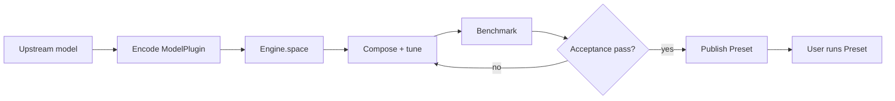

# Model adaptation workflow

Agent-native does not mean asking an agent to understand the whole repository and
freely patch whatever it finds. It means the engine presents a bounded, testable
adaptation contract that agents of different capability can follow.

## The boundary

Before a model is integrated, the problem may include model code, architecture code,
runtime code, optimization implementations, composition, and tuning. The model plugin
absorbs the first three. Reusable optimization providers absorb the fourth. After that,
the agent's search domain is composition and tuning only.



## Adaptation checklist

### 1. Establish semantics

- Identify the Diffusers pipeline or component layout used as the semantic
  reference.
- Freeze the official prompt, seed, resolution, frame count, steps, scheduler, and
  output processing in `profile.toml`.
- Produce reference artifacts before changing execution.

If no Diffusers implementation exists, document the upstream semantic owner rather
than copying the architecture into Sol.

### 2. Encode verified seams

Inspect the model and mark only structural seams that exist and are reachable:
transformer blocks, denoise steps, swappable attention, FFN linears, token axes, and
kernel-fusion hooks. A requested optimization is not evidence that a seam exists.

### 3. Implement a backend adapter

Map an optimization ID to exact model stages and compile its options into the runtime
configuration. Every supported option needs a consumer. Unknown or unsupported options
must fail; silently ignoring a knob is forbidden.

Start with a dense path. For a performance claim, keep model semantics and topology
fixed between dense and optimized arms.

### 4. Ask the engine for the domain

```python
engine.space("new_model", backend="sglang").as_dict()
```

Do not create another registry or a hand-written search-space file. If the result is
missing an optimization, fix the model capability evidence, backend integration, or
optimization parameter schema at its owner.

### 5. Search through the public API

```python
candidate = (
    engine.optimize("new_model", backend="sglang")
    .use("step_cache", threshold=0.1)
    .preset(name="candidate-001")
)
plan = engine.inspect(candidate)
```

An agent may implement any search policy around this API. It should log candidate
fingerprints, parameters, timing evidence, and rejection reasons. The search policy is
not part of the runtime product.

### 6. Gate and promote

The model-owned `acceptance.toml` is fail-closed. Promotion requires the declared
artifacts, official-config match, performance threshold, completed warmup, and quality
gate. Also verify that the optimization actually engaged; a fast no-op is not a result.

Serialize the accepted candidate under `sol/plugins/<model>/presets/`. Add the model's
lazy discovery metadata to `sol/catalog.toml`, mark it `released`, and add control-plane
tests. Users now run exactly what the adaptation agent produced.

## Evidence rules

- State the performance denominator and topology.
- Keep load/compile timing separate from steady-state inference timing.
- Use same prompt, seed, scheduler, dimensions, and step count.
- Record non-bit-exact behavior for sparse, quantized, or reduction-order-changing paths.
- Keep generated videos, logs, and run records outside Git; preserve compact golden
  metadata and acceptance summaries under `benchmarks/`.

## Done means releasable

A model is not complete because a patched script runs once. It is complete when:

- discovery is side-effect free;
- the backend maps every advertised option;
- `Engine.space()` exposes only executable choices;
- a preset resolves deterministically;
- dry-run has no side effects;
- the acceptance contract passes with reproducible evidence;
- the same preset is the documented user entry point.
