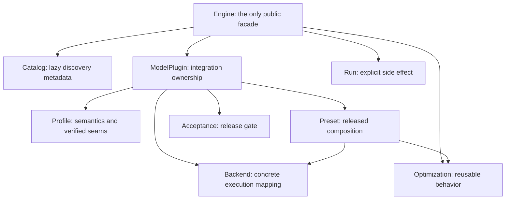

# Architecture

Sol's architecture is organized around ownership. A model integration owns its
semantics, backend mappings, presets, and acceptance gate. Reusable optimizations
own model-independent policy. The engine connects them without import side effects.

## Product graph



The catalog contains canonical `module:qualname` references and small discovery
metadata. Listing it does not import a provider. The selected model plugin and
optimization providers are loaded only while resolving a preset or candidate.

## Model implementation policy

Sol does not own a third model zoo.

| Layer | Owner | Purpose |
| --- | --- | --- |
| Semantic reference | Diffusers | components, configs, processors, expected model behavior |
| Performance execution | SGLang | optimized runtime, distributed execution, graph/kernels |
| Optimization product | Sol | portable optimization contracts, model/backend adapters, presets, release evidence |

This is a policy, not a requirement that every model must run on both frameworks on
day one. A plugin can initially expose a Diffusers reference and one SGLang execution
backend. The boundary ensures another backend can be added without changing public
optimization IDs or the preset selection API.

Correctness and speed use different controls:

- Diffusers provides a semantic oracle and reference artifacts.
- A performance claim uses a dense same-backend, same-topology baseline.
- A cross-framework timing can be reported as system comparison, but not as the
  optimization stack's speedup denominator.

## ModelPlugin is the adaptation unit

One directory under `sol/plugins/<model>/` is the complete release unit:

```text
profile.toml
backends/
  sglang.py
references/
  diffusers.py
presets/
  fullopt.toml
acceptance.toml
launch/
  baseline.toml
  fullopt.toml
```

The profile describes official workload semantics and verified structural seams.
The backend maps generic optimizations to exact runtime stages and settings. The
preset selects a composition and parameters. The acceptance file defines evidence
required to promote that preset.

Stages are model-owned. An agent may ask for `step_cache(skip="16-28")`; it may not
guess whether the cache belongs in stage 1 or stage 2. The plugin fills that fact in
and rejects any conflicting request.

## Derived tuning domain

`Engine.space(model, backend)` intersects three facts:

1. optimizations present in the lazy catalog;
2. capabilities derived from verified model seams;
3. integrations implemented by the selected backend.

It then attaches each optimization's machine-readable parameter schema. The result
is not a hand-maintained `search_space/` tree. It cannot advertise an optimization
that the backend does not know how to execute.

Search itself is an optional policy. Grid search, Bayesian optimization, or an agent
can consume the same space and construct candidates through `Engine.optimize()`.
The accepted candidate is a normal model-owned preset.

## Side-effect boundary

Discovery, `space`, preset resolution, composition, inspection, and dry-run are
pure with respect to the filesystem and processes. They may import only the selected
providers.

`Run.execute()` launches a process. `Run.save()` writes a record. Both are explicit.
An actual run defaults to `${XDG_STATE_HOME:-~/.local/state}/sol/runs`, keeping
generated evidence out of the source tree.

## Why no registration decorators

The catalog is serialization metadata, not a global Python object registry. Provider
classes do not register themselves at import time. Scoped catalog merges are explicit
and duplicate IDs fail closed.

This keeps provider loading lazy, makes ownership visible, and prevents a central
registry from becoming the edit hotspot for every model and optimization. More
importantly, it lets agents inspect the legal domain without executing unrelated model
code.
