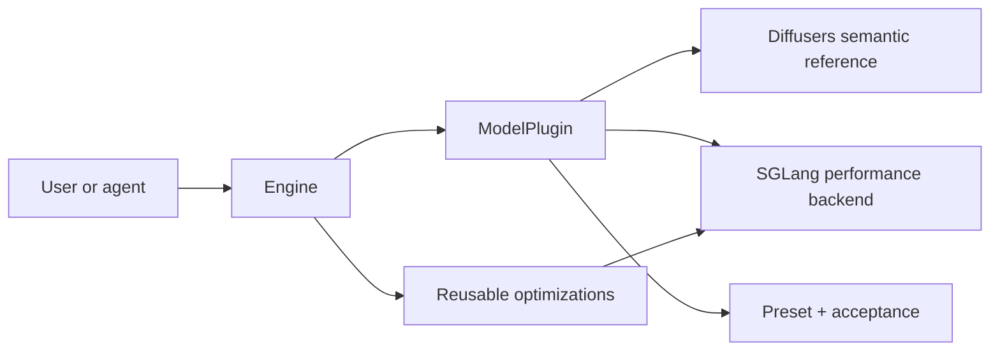

# Sol-Engine

Sol is a composable optimization engine for video generation. Users run a model-owned
preset; advanced users and adaptation agents inspect the same legal optimization domain
and compose candidates through the same API.

## Product contract

```bash
sol models
sol inspect ltx23:fullopt --json
sol space ltx23 --backend sglang
sol run ltx23:fullopt --dry-run
```

The current end-to-end migrated release is `ltx23`. Other catalog entries are retained
as `profile_only` migration inputs until a backend, preset, and acceptance contract are
complete.

## Architecture in one view



Sol does not maintain a third full model zoo. It owns portable optimization contracts,
model/backend integrations, and releases. See [Architecture](architecture.md).

## Why the same API matters

Model modularity is not only an end-user convenience. Once verified model seams and
backend mappings are encoded, `Engine.space()` shrinks an adaptation agent's domain
from arbitrary code/model/architecture/optimization search to optimization composition
and parameters. The accepted candidate is serialized as the preset users run.

See [Model adaptation workflow](agent-workflow.md).

## Reusable optimization families

| Family | Examples |
| --- | --- |
| [Cache](techniques/cache.md) | TeaCache, EasyCache, fixed-step reuse |
| [Quantization](techniques/quant.md) | NVFP4 FFNs and dense guards |
| [Kernel fusion](techniques/kernel.md) | AdaLN, QK-norm/RoPE, epilogues, compile |
| [Sparse attention](techniques/sparse.md) | Sol-Attn, PISA, routing policies |
| [Token pruning](techniques/token_prune.md) | feature-norm pruning, merge/restore |

## Start here

- [Installation](installation.md)
- [Engine API](control-plane.md)
- [Run a preset](run.md)
- [Architecture](architecture.md)
- [Model adaptation workflow](agent-workflow.md)
